<div align="center">

# GT86 Dash

**A gauge cluster for the Toyota GT86, built from a Raspberry Pi Pico W and a 2" screen.**

Oil, coolant, intake, AFR, battery and ethanol at a glance, in the GT86's own red-orange,
a race-wheel shift light across the top, and every drive logged to your phone.

[](https://github.com/zedensix/can_display/actions/workflows/ci.yml)
[](LICENSE)


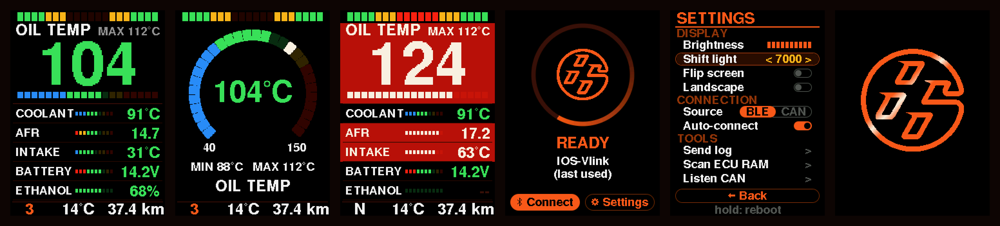

</div>

## Highlights

- **Reads the car without a wire.** An ELM327 Bluetooth LE OBD dongle in the OBD port is
  enough; an MCP2515 CAN module can be wired instead, picked in the settings.
- **Looks like it came with the car.** Black, red-orange around the readings, segment gauges
  colored by band: green fine, amber warns, a reading in danger blinks its whole tile red,
  blue is an engine not warm yet.
- **Knows when you're on track.** With the traction or stability control off, the gauges
  switch to a track layout, the oil and the AFR big, under a TRC OFF or VSC OFF badge (the
  CAN bits it reads are found, still to be confirmed on a second run).
- **Says what matters.** From 130°C the oil temperature takes the whole screen. The AFR stays
  calm off the throttle, when the fuel cut reads lean. A reading too old shows `--`, never a
  frozen number.
- **Reads what the ECU doesn't publish.** The oil temperature through Toyota's Mode 21, the
  ethanol % of a flex-fuel tune straight from the engine ECU's RAM.
- **Logs every drive.** Five readings a second to its own flash; "Send log" hands them to a
  phone, and a small self-hosted site keeps every session and charts it.
- **Knows the car is off.** It lets the dongle sleep and turns its own screen off; a click
  wakes it. Left waiting, it shows a screensaver of the badge and the logos of the parts on the
  car.

## The screens

| | | |
|:-:|:-:|:-:|
| 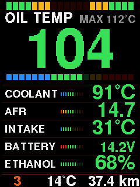 | 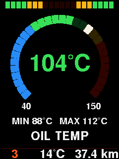 | 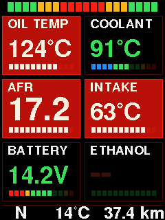 |
| **Every gauge**, with the shift light | **One gauge alone**, its session's min and max | **Alarms**: the tile blinks red |
| 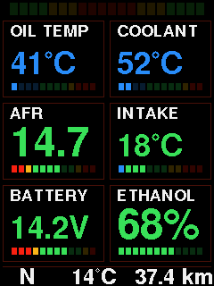 | 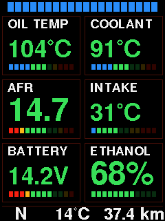 |  |
| **Cold engine**: blue, don't rev it yet | **Shift light**, lit in pairs from both ends | **Oil at 130°C**: the whole screen |
| 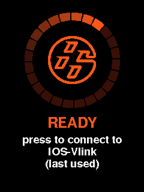 | 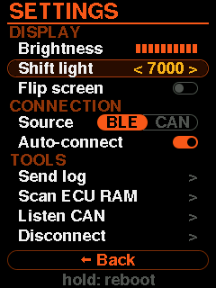 |  |
| **Ready**: connect, or the settings | **Settings**, one screen, on the knob | **Screensaver**, nothing connected |
| 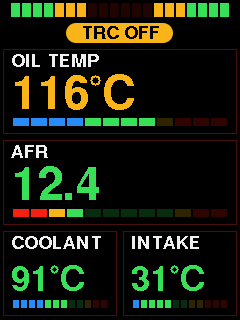 | 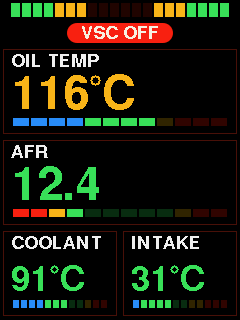 |  |
| **TRC off**: the track layout | **VSC off**: everything off, in red | **Starting up**: the ring closes into the logo |

A rotary encoder drives it all: turn for the views, click for the settings, hold to reboot.
Every picture here comes from the UI code itself (`mise run ui`), the same code the firmware
runs.

## Every drive, logged

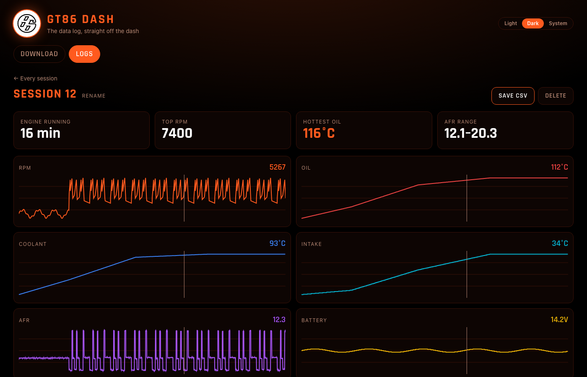

"Send log" turns the dash into a Bluetooth peripheral; the log page, opened in Chrome on
Android, downloads the whole log and sends it to its server. The server keeps each session
once, however many times it's sent, even after the dash's flash ring has overwritten it.
The list pages, searches and filters by date; a session can be named, and gets its peaks,
a chart per signal (throttle included), a cursor across them all, and a CSV. Light, dark or
the device's theme.


The page self-hosts with the `Dockerfile` (port 3000, the logs in its `/data` volume), behind
an https reverse proxy: Web Bluetooth needs https, and the proxy is what asks who's there.

## Hardware

| Part | For | Notes |
| --- | --- | --- |
| Raspberry Pi Pico W (or WH) | the brain, and Bluetooth | RP2040, 2MB flash |
| ST7789 V2.2 2.0" 240x320 SPI display | the screen | in portrait |
| KY-040 rotary encoder (EC11) | turn, click, hold | wired on its own legs, the Pico's pull-ups |
| ELM327 Bluetooth LE OBD dongle | the car's data, wireless | tested with a Vgate iCar Pro 2S |
| *or* MCP2515 + TJA1050 CAN module | the car's data, wired | on OBD pins 6 and 14, its SO through a resistor divider (5V to 3.3V) |
| 12V to 5V converter | power | from a switched 12V, into the Pico's USB socket |
| Printed faceplate and tray | holding it all | modeled in code, see below |

The full pin map and power: [docs/wiring.md](docs/wiring.md).


`bun run wiring` opens the diagram in a browser: zoom, follow a wire, turn a board over,
switch between the dongle and the wired CAN.

## The enclosure

<p>
  
  
  
</p>

A faceplate holds the display and the encoder; a tray behind it carries the Pico, the CAN
board and the converter. Both are modeled in TypeScript (scad-js) from the modules' measured
dimensions, print without supports, and come out as STLs with `mise run faceplate`. The
wiring page's Dimensions tab is where the measurements go in. More in
[faceplate/README.md](faceplate/README.md).

## Getting started

1. Install [mise](https://mise.jdx.dev), then `mise install`: the ARM toolchain, CMake, Bun
   and the rest, pinned, and the git hooks.
2. `mise run sim` opens the dash in a window, with made-up data: the arrows turn the knob,
   space clicks (the simulator needs SDL2: `brew install sdl2`).
3. `mise run firmware` builds `bin/firmware.uf2`; `mise run flash` builds and flashes a Pico
   on USB, rebooting it into BOOTSEL by itself.
4. In the car: plug the dongle in, power the dash from a switched 12V, click Connect.

## Development

```sh
mise run sim          # the dash in a window, made-up data
mise run test         # host tests of the UI and data code, with ASan and UBSan
mise run firmware     # bin/firmware.uf2, and bin/firmware-sim.uf2 with made-up data
mise run flash        # build and flash a Pico on USB
mise run logs         # the log the Pico keeps in flash: boots, connections, dongle answers, crashes
mise run ui           # every screen as a picture in ui/, and the showcase above
mise run faceplate    # the printed parts: STLs and renders
mise run logo         # the boot splash, from 86.png
mise run logos [dir]  # the screensaver's parts' logos, from your own folder (kept out of git)
bun run dev           # the log site on localhost:3000
bun test web          # the log site's store
bun run wiring        # the wiring diagram and the modules' dimensions
mise run wiring       # its pictures, for docs/wiring.md
mise run web-pictures # the log site's pictures, from made-up drives
```

The CI runs every hook (clang-format, Biome, `bun check` for the types, the tests) and builds the firmware.

## What works today

| Signal          | Source                                              | Status |
| --------------- | --------------------------------------------------- | ------ |
| RPM (shift light) | OBD PID 0x0C (dongle), or broadcast `0x140` (CAN) | PID is standard; `0x140` **unverified on this car** |
| Coolant temp    | OBD PID 0x05 (dongle), or broadcast `0x360` (CAN)   | PID is standard; `0x360` **unverified on this car** |
| Intake air temp | OBD PID 0x0F (dongle)                               | PID is standard; the ECU lists it as supported |
| Oil temp        | Toyota Mode 21 PID 01 (dongle), or broadcast `0x360` (CAN) | Mode 21 checked on this car against another gauge; `0x360` **unverified** |
| AFR             | OBD PID 0x24 (wide-range O2 sensor 1)               | The ECU lists the PID as supported; values **not cross-checked** |
| Throttle        | OBD PID 0x11 (dongle)                               | Read on this car; tells a lean AFR off the throttle from a real one |
| Battery voltage | The dongle's `ATRV`                                 | Read on hardware (dongle only) |
| Ethanol %       | The engine ECU's RAM at 0xFFF87C7C (dongle)         | Found by scans and matched against OFT on this car; specific to this tune |

The CAN IDs and formulas come from community reverse-engineering, not factory documentation:
**don't trust them blindly**. [docs/can-reverse-engineering.md](docs/can-reverse-engineering.md)
covers how to check them on your own car, and the dash's own tools for it: a scan of the
ECU's RAM, and a guided listen of the CAN bus.

## Design notes

- **One UI, three targets.** The firmware, the simulator and the tests all draw through the
  same code into an RGB565 canvas; the firmware pushes it to the panel with DMA. The simulator
  is a pixel-exact preview, so UI work happens there.
- **Single loop, no RTOS.** The Bluetooth stack runs from the main loop, between frames and
  while the DMA pushes one. No interrupt races the UI, and the ELM327 session is a
  non-blocking state machine with timeouts and retries.
- **Failures are visible.** The data source says what it's doing on the panel and what went
  wrong. A watchdog reboots a frozen board, a panic is written to the flash log before
  rebooting, and a hard fault is reported at the next boot.
- **Thresholds live in one place**, the ranges at the top of `src/app/ui/ui.c`.

## License

MIT ([LICENSE](LICENSE)), except the font data in `src/app/ui/fonts.c`: FreeSans Bold from
GNU FreeFont, GPLv3 with the font exception. The 86 logo (`86.png`, `src/app/ui/logo.c`) is
Toyota's trademark, not covered by the MIT license. The screensaver's other logos, the car's
parts' makers', aren't in the repository: `mise run logos` builds them in from your own
folder.
