<div align="center">

# GT86 Dash

**A gauge cluster for the Toyota GT86, built from a Raspberry Pi Pico W and a 2" screen.**

Oil, coolant, intake, AFR, battery and ethanol at a glance, in the GT86's own red-orange,
a race-wheel shift light across the top, and every drive logged to your phone.

[](https://github.com/zedensix/can_display/actions/workflows/ci.yml)
[](LICENSE)


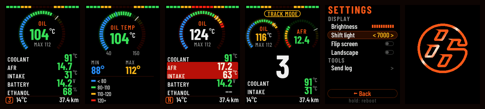

</div>

## Highlights

- **Reads the CAN bus itself.** An MCP2515 CAN module on the OBD port's CAN pins listens to
  what the car broadcasts many times a second and asks the engine ECU for the rest.
- **Looks like it came with the car.** Black, red-orange around the readings, segment gauges
  colored by band: green fine, amber warns, a reading in danger blinks its whole tile red,
  blue is an engine not warm yet.
- **Knows when you're on track.** With the traction or stability control off, the gauges
  switch to a track layout, the oil and the AFR big, under a badge for each mode past comfort
  (everything on): DRIFT (TRC off), SPORT (VSC sport), TRACK (both), RACE (everything off),
  read from bits two listens of the CAN bus agreed on.
- **Says what matters.** From 130°C the oil temperature takes the whole screen. The AFR stays
  calm off the throttle, when the fuel cut reads lean. A reading too old shows `--`, never a
  frozen number.
- **Reads what the ECU doesn't publish.** The oil temperature off the car's own bus, the
  ethanol % of a flex-fuel tune straight from the engine ECU's RAM.
- **Logs what checks the tune.** Besides the gauges: pedal, throttle, load, timing, both fuel
  trims, the AFR the ECU commands beside the one it gets, the direct injection rail's pressure
  and the speed, five times a second to its own flash; "Send log" hands them to a
  phone, and a small self-hosted site keeps every session and charts it.
- **Waits for the car.** Powered before the ignition wakes the bus, it says so and keeps
  listening; left waiting, it shows a screensaver of the badge and the logos of the parts on
  the car.

## The screens

| | | |
|:-:|:-:|:-:|
| 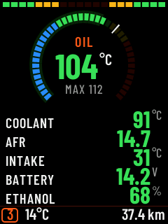 | 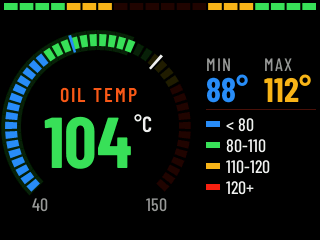 | 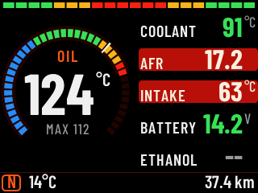 |
| **Every gauge**: the oil first, the rest as a list | **One gauge alone**, its session's min and max | **Alarms**: the row blinks red |
| 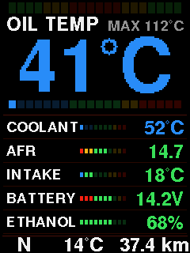 | 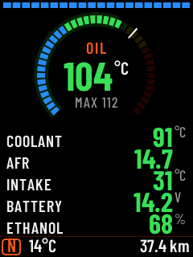 |  |
| **Cold engine**: blue, don't rev it yet | **Shift light**, lit in pairs from both ends | **Oil at 130°C**: the whole screen |
| 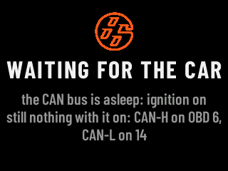 | 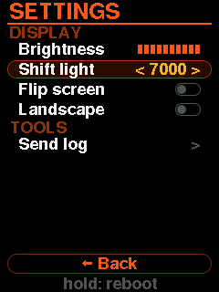 |  |
| **Waiting for the car**: the bus asleep | **Settings**, one screen, on the knob | **Screensaver**, nothing coming in |
| 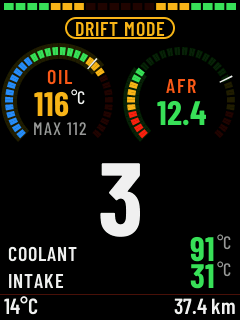 | 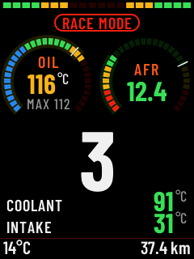 |  |
| **Drift mode** (TRC off): the track layout | **Race mode**: everything off, in red | **Starting up**: the ring closes into the logo |
| 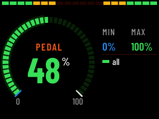 | 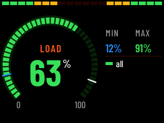 |  |
| **Pedal**, a view on the knob | **Engine load**, another | **Near the limiter**: the whole screen flashes |
| 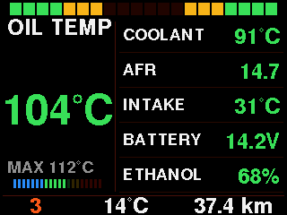 | 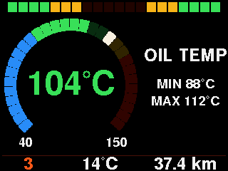 | 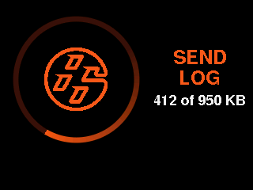 |
| **Landscape**, the panel on its side | **A gauge alone**, its extremes beside it | Every screen turns with it |
| 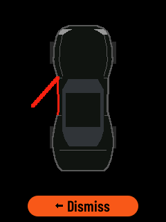 | 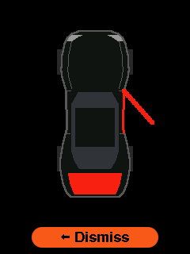 | 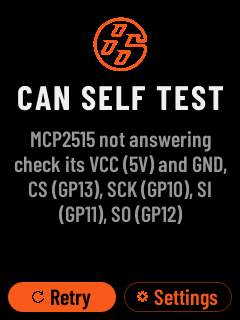 |
| **A door open**: which, on the car | **Several**: each swung out | **CAN self test**: which wire to check |

Along the bottom of the gauges: the gear engaged (worked out from the RPM and the speed), the
temperature outside and the distance driven. A rotary encoder drives it all: turn for the
views, click for the settings, hold to reboot. The screen turns a quarter turn in the
settings, for a panel mounted on its side.
Every picture here comes from the UI code itself (`mise run ui`), the same code the firmware
runs.

## Every drive, logged


"Send log" hands it over the dash's Bluetooth link, the gauges paused meanwhile; the log
page, opened in Chrome on Android, downloads the whole log and sends it to its server. The server keeps each session
once, however many times it's sent, even after the dash's flash ring has overwritten it.
The list pages, searches and filters by date; a session can be named, and gets its peaks,
a chart per signal (throttle included), a cursor across them all, and a CSV. Light, dark or
the device's theme.

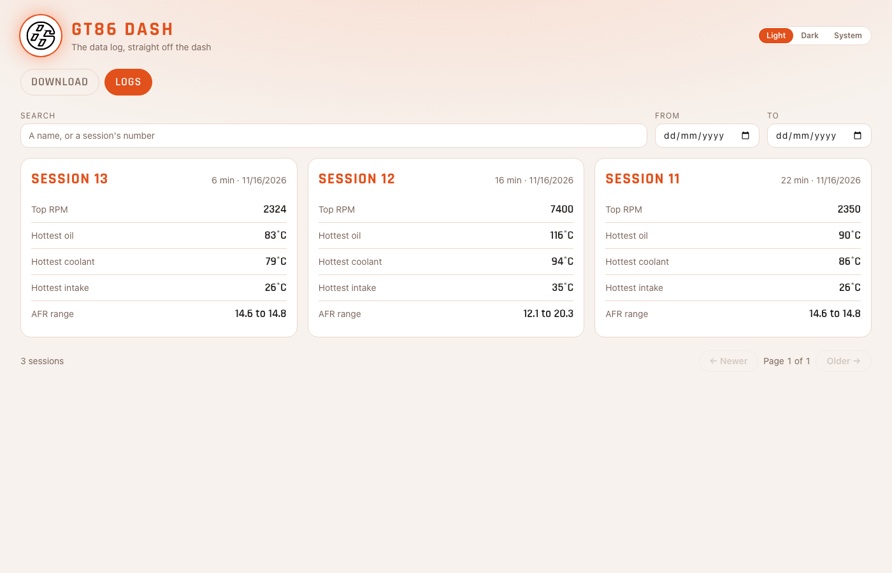

The page self-hosts with the `Dockerfile` (port 3000, the logs in its `/data` volume), behind
an https reverse proxy: Web Bluetooth needs https, and the proxy is what asks who's there.

## Hardware

| Part | For | Notes |
| --- | --- | --- |
| Raspberry Pi Pico W (or WH) | the brain, and Bluetooth for Send log | RP2040, 2MB flash |
| ST7789 V2.2 2.0" 240x320 SPI display | the screen | in portrait |
| KY-040 rotary encoder (EC11) | turn, click, hold | wired on its own legs, the Pico's pull-ups |
| MCP2515 + TJA1050 CAN module | the car's data | on OBD pins 6 and 14, its SO through a resistor divider (5V to 3.3V) |
| 12V to 5V converter | power | from a switched 12V, into the Pico's USB socket |
| Printed bar and its base | holding it all | modeled in code, see below |

The full pin map and power: [docs/wiring.md](docs/wiring.md).

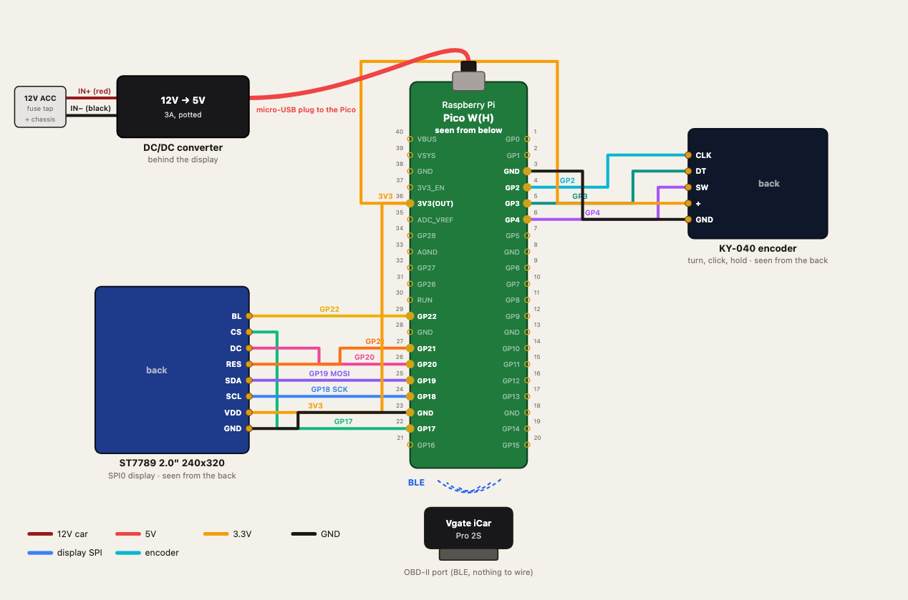

`bun run wiring` opens the diagram in a browser: zoom, follow a wire, turn a board over.

## The enclosure

<p>
  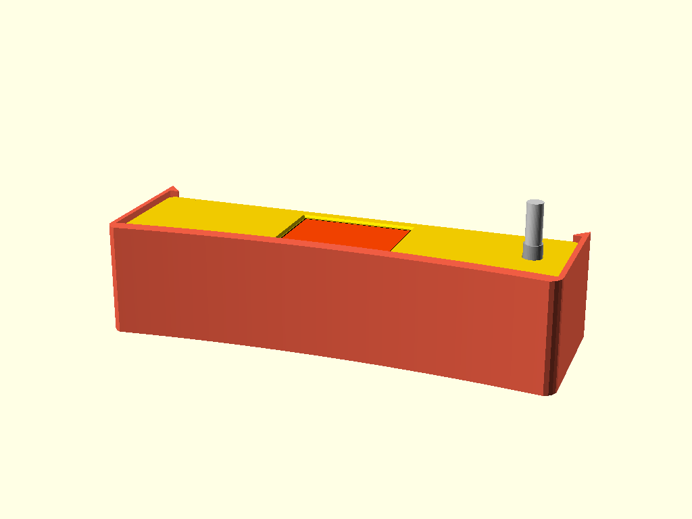
  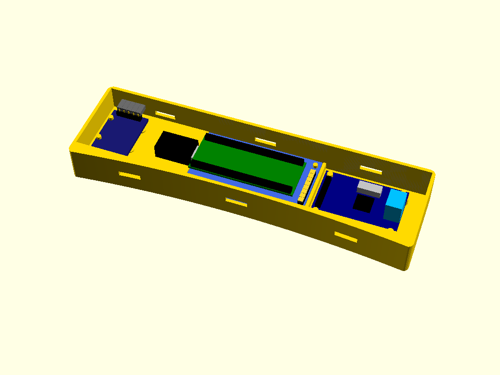
</p>

One long, thin box on the steering column's shroud: the display in the middle with the Pico
behind it, the encoder and the CAN board either side. It clips into a base, the only part
taped to the car. Modeled in TypeScript (scad-js) from the modules' measured dimensions, it
prints without supports and comes out as STLs with `mise run faceplate`. The wiring page's
Dimensions tab is where the measurements go in. More in
[faceplate/README.md](faceplate/README.md).

## Getting started

1. Install [mise](https://mise.jdx.dev), then `mise install`: the ARM toolchain, CMake, Bun
   and the rest, pinned, and the git hooks.
2. `mise run sim` opens the dash in a window, with made-up data: the arrows turn the knob,
   space clicks, l turns it to landscape (the simulator needs SDL2: `brew install sdl2`).
3. `mise run firmware` builds `bin/firmware.uf2`; `mise run flash` builds and flashes a Pico
   on USB, rebooting it into BOOTSEL by itself.
4. In the car: wire the MCP2515 to the OBD port, power the dash from a switched 12V.

## On the head unit: Android Auto

The same gauges, bigger, on the car's Android Auto screen: an app on the phone (`android/`,
Kotlin) that Android Auto runs as a navigation app, its map the gauges. Every gauge with the
oil as a big dial, arrows to turn the views and a cog for the settings (the shift light's RPM,
the min and max reset), the track layout past comfort, each gauge alone with its session's lowest
and highest, the oil too hot over the whole screen, the shift light across the top. The dash
sends it its readings over Bluetooth LE many times a second; a Demo setting makes them up. On
the phone itself, turned as the phone is: swipe across the gauges to turn the views, and a bar
to Home, Laps, Map and Settings (how the link is doing, which dash it connects to).

The app also records. Every minute it pulls what the dash logged since the last pull, without
pausing the gauges, and keeps each session on the phone. It backs them up as CSV, with the drives
as GPX, into a folder on the phone or a WebDAV folder (Penombre). The phone's GPS gives lap
times: on the Laps page, tap "Set the start line here" crossing the line; the lap running shows
there big, and along the bottom of the gauges with the best and the last. A spirited drive,
started on the Map page, records the way you drive; the Map page shows each drive on a map,
colored by speed, with its laps.

```sh
mise run android:flash # build, install on the phone (USB or Wi-Fi debugging), open it
mise run android:dhu   # Android Auto on the laptop, from the phone on USB
```

In the car, Android Auto only runs apps from the Play Store: the app goes through an internal
test track.

## Development

```sh
mise run sim          # the dash in a window, made-up data
mise run test         # host tests of the UI and data code, with ASan and UBSan
mise run firmware     # bin/firmware.uf2, and bin/firmware-sim.uf2 with made-up data
mise run flash        # build and flash a Pico on USB
mise run logs         # the log the Pico keeps in flash: boots, the CAN self test, Send log, crashes
mise run ui           # every screen as a picture in ui/, and the showcase above
mise run faceplate    # the printed parts: STLs and renders
mise run logo         # the boot splash, from 86.png
mise run logos [dir]  # the screensaver's parts' logos, from your own folder (kept out of git)
bun run dev           # the log site on localhost:3000
bun test web          # the log site's store
bun run wiring        # the wiring diagram and the modules' dimensions
mise run wiring       # its pictures, for docs/wiring.md
mise run web-pictures # the log site's pictures, from made-up drives
```

The CI runs every hook (clang-format, Biome, `bun check` for the types, the tests) and builds the firmware.

## What works today

| Signal          | Source                                              | Status |
| --------------- | --------------------------------------------------- | ------ |
| RPM (shift light) | Broadcast `0x140`                                 | Checked on this car (reads right in use) |
| Coolant temp    | Broadcast `0x360`                                   | Checked on this car (reads right in use) |
| Oil temp        | Broadcast `0x360`                                   | Checked on this car (reads right in use) |
| Intake air temp | OBD PID 0x0F                                        | Checked on this car |
| AFR             | OBD PID 0x24 (wide-range O2 sensor 1)               | Checked on this car |
| Throttle        | OBD PID 0x11                                        | Checked on this car; tells a lean AFR off the throttle from a real one |
| Battery voltage | OBD PID 0x42, the engine ECU's supply               | Checked on this car; a few tenths under the battery's |
| Ethanol %       | The engine ECU's RAM at 0xFFF87C7C                  | Found by scans and matched against OFT on this car; specific to this tune |
| Pedal, load, timing, fuel trims, commanded AFR, DI rail pressure, speed, outside temperature | OBD PIDs 0x5A, 0x04, 0x0E, 0x06/0x07, 0x44, 0x23, 0x0D, 0x46 | Checked on this car |
| Gear | RPM over speed, the manual gearbox's ratios | Checked on this car |
| Odometer | Not asked | The dash shows the trip since boot |

Every reading above is checked on this car, a 2015 GT86. The CAN IDs and formulas come from
community reverse-engineering, not factory documentation: on another car or another tune, check
them first. [docs/can-reverse-engineering.md](docs/can-reverse-engineering.md) covers how, and how
this one's were found.

## Design notes

- **One UI, three targets.** The firmware, the simulator and the tests all draw through the
  same code into an RGB565 canvas; the firmware pushes it to the panel with DMA. The simulator
  is a pixel-exact preview, so UI work happens there.
- **Two cores, one loop.** Core1 only reads the CAN bus into a queue, as fast as SPI goes;
  core0 decodes it, draws, and runs the Bluetooth stack for Send log between frames. No RTOS,
  no interrupt racing the UI.
- **Failures are visible.** The CAN self test says on the panel which wire to check. A watchdog reboots a frozen board, a panic is written to the flash log before
  rebooting, and a hard fault is reported at the next boot.
- **Thresholds live in one place**, the ranges at the top of `pico/src/app/ui/ui.c`.

## License

MIT ([LICENSE](LICENSE)), except Barlow Condensed, the Android app's
(`android/app/src/main/res/font`) and the dash's font data generated from it (`pico/src/app/ui/fonts.c`),
SIL Open Font License 1.1 (`android/app/src/main/assets/OFL.txt`); and the app's icons, Material
Symbols, Apache 2.0. The 86 logo (`86.png`, `pico/src/app/ui/logo.c`) is
Toyota's trademark, not covered by the MIT license. The screensaver's other logos, the car's
parts' makers', aren't in the repository: `mise run logos` builds them in from your own
folder.
