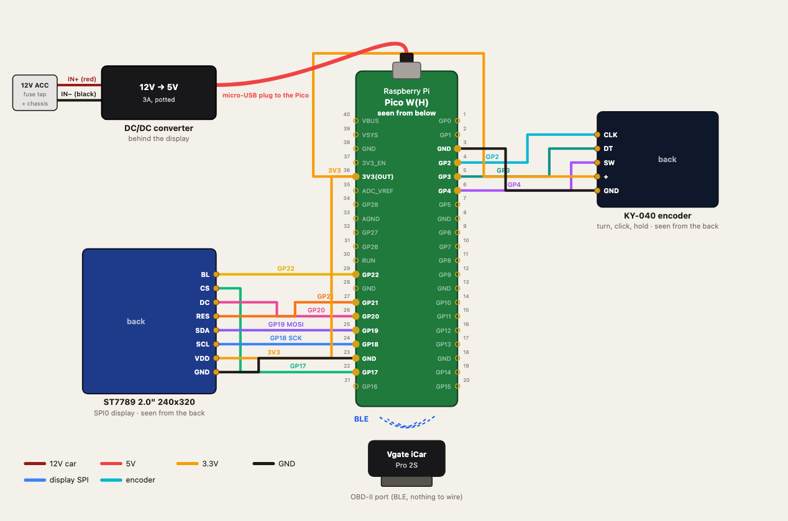
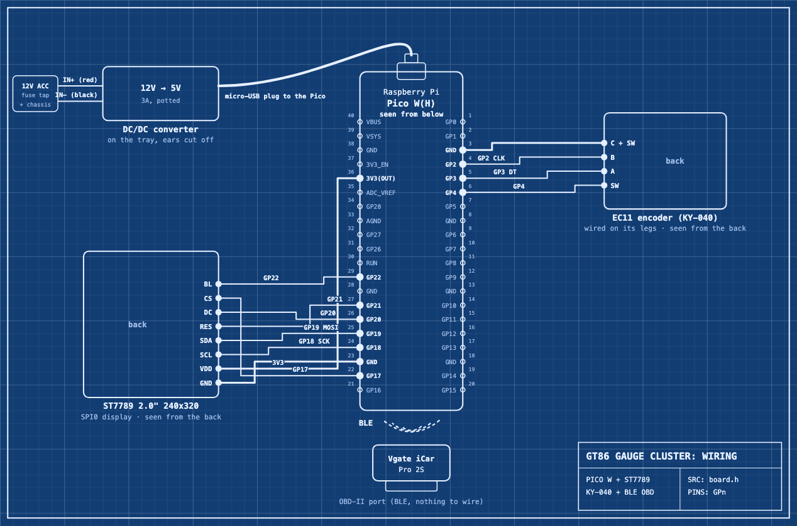

# Reference wiring

This matches the pin constants in `src/firmware/board.h`.
Change either the wiring or the constants if yours differs: they just
need to agree. The wiring page draws it in a browser, in color or as a
blueprint. It draws each module with its header in its real order, from
the side you wire it from: the Pico from below, the modules from their
back; a click turns any of them over, and a button switches between the
BLE dongle and the wired MCP2515. A click on a wire follows it. `bun run
wiring` opens it, along with the modules' dimensions for the printed
parts; `mise run wiring` captures it into the pictures below, as it
opens (rerun it when the wiring changes).

Board target: `pico-w` (Raspberry Pi Pico W / WH). GPIO23, 24, 25 and
29 are used by the wireless chip on the W, so don't wire anything to
them. Pin numbers below are GPn, not physical pin numbers.

## Display: ST7789 V2.2, 2.0" 240x320 SPI TFT

| Display pin | Pico W pin | Notes |
|---|---|---|
| SCL | GP18 | SPI0 clock (SCK), despite the I2C-style name |
| SDA | GP19 | SPI0 data out (MOSI), despite the I2C-style name |
| CS | GP17 | |
| DC | GP20 | |
| RES | GP21 | |
| BL | GP22 | backlight; driven high in software |
| VDD | 3V3(OUT) | most of these panels are 3.3V logic *and* power, double check yours |
| GND | GND | |

It's SPI, not I2C: no MISO, the display is write-only.

## Rotary encoder: KY-040 (EC11)

Wired on the EC11's own legs, through the KY-040 board's holes, not on
its header (whose pads can lift off when resoldering it): the legs are
a row of 3 (A, C in the middle, B) and a row of 2 (the button). The
Pico's internal pull-ups on GP2, GP3 and GP4 replace the board's, so
nothing powers the encoder. The board's own traces already tie C to one
button leg: one GND wire for both, and no bridge to add (one from C to the
other leg shorts the button: stuck pressed, and the 1s hold reboots in a
loop). With a multimeter, the button leg that beeps with C is that one;
GP4 goes on the other (on the KY-040, the one next to R1).

**Remove R2 and R3** (the board's 10K pull-ups on A and B): they go to
+, and with + unwired they tie A and B together through 20K. A closed
contact then drags the other line to about 0.9V, which the RP2040 reads
either way: the knob skips every other click. Without them, the Pico's
internal pull-ups do the job (or wire + to 3V3(OUT) and keep them).

| EC11 leg | Pico W pin | Notes |
|---|---|---|
| B (row of 3, an end) | GP2 | quadrature (the header's CLK), read on interrupts |
| A (row of 3, the other end) | GP3 | quadrature (the header's DT) |
| button leg not tied to C (next to R1) | GP4 | push button, active low (the header's SW) |
| C (row of 3, middle) | GND | the board ties the other button leg to it |

With its header intact, the same goes through it: CLK, DT and SW as
above, GND, and + left unwired (or on 3V3(OUT), never 5V: the board's
pull-ups go to +, and the RP2040 isn't 5V tolerant).

Turn on the gauges: every gauge, then each one alone, big. Click on the
gauges: settings page (turn to pick a row, click to change it, Back to
leave); while the screen says "press to connect" or "press to retry",
the click goes to the connection instead. Hold 1s: reboot. If turning
goes the wrong way, swap A and B (CLK and DT). `STEPS_PER_DETENT` in
`src/firmware/hardware/knob.c` is 2, for a half-step encoder (the one on this
car); if one click moves two rows, it's a full-step one: set it to 4.

Keep GP15 free: the pico-sdk drives it briefly at boot for the RP2040 USB
enumeration workaround (erratum RP2040-E5).

## Power

On the bench, USB is enough. In the car, the Pico W needs 5V from the
car's 12V through a **12V to 5V converter**. Never wire 12V to the
Pico: the car's electrical system has spikes far beyond what it takes.
The one used here is a potted automotive module (12/24V in, 5V 3A out)
whose output is a micro-USB plug: it goes straight into the Pico's USB
socket, like a phone charger.

| From | To | Notes |
|---|---|---|
| switched 12V (fuse tap on an ACC/ignition fuse) | converter IN+ (red) | see below |
| chassis ground | converter IN- (black) | |
| converter micro-USB plug | the Pico's USB socket | 5V on VBUS (physical pin 40) |

- **Take a switched 12V, not OBD pin 16.** Pin 16 is live with the car
  off: the Pico would keep scanning for the dongle and drain the
  battery overnight.
- Anything needing 5V (the MCP2515 board, a 5V sensor) takes it from
  VBUS (physical pin 40).
- The Pico has one USB socket: to flash or run `mise run logs` in the
  car, unplug the converter and plug the Mac's cable instead.

## Car data, option A (default): ELM327 Bluetooth LE OBD dongle

Selected by **Data source: BLE** in the dash's settings (the default);
changing it reboots the dash. Nothing to wire: plug the dongle into the OBD port, the Pico W connects
to it over BLE with its onboard radio. Written for a Vgate iCar Pro 2S,
seen working on hardware: it advertises no name, and serves its serial
port on service `18f0` (notify `2af0`, write `2af1`). It answers `ATI`
with `ELM327 v2.3`. The car side (PIDs answering, values) isn't
verified yet.

- The dongle must speak **BLE**, not only Bluetooth Classic: the
  firmware only does BLE. A dongle that works with iPhones does.
- Only one client at a time. If your phone (Car Scanner...) is
  connected to it, the Pico won't find it: turn the phone's Bluetooth
  off.
- What you get: RPM, coolant, AFR (standard OBD PIDs), battery
  voltage (the dongle's `ATRV`), and oil temperature through Toyota's
  Mode 21 PID 01 asked to the engine ECU (community-sourced, checked
  on this car against another gauge). Ethanol % isn't available over
  standard OBD (the ECU doesn't support PID 0x52): the dongle reads it
  from the engine ECU's RAM, where the flex-fuel tune keeps it.
- Slower than the CAN option: every value is a request/answer through
  the dongle, a few refreshes per second at best.
- No pairing: these dongles take any BLE client without a PIN. The
  Pico connects to the first device that looks like one; set
  `ELM_ADDRESS` in `src/firmware/ble/ble.c` to lock it to yours.
- Until data flows, the panel shows a status screen: scanning (with
  the last device it ignored), connecting to (name and MAC), reading
  services, init. The flash log (`mise run logs`) also lists the
  dongle's GATT services and its raw answers to a few probes.
- If the scan never stops on your dongle, its name and services match
  nothing known: read them with a phone BLE scanner (nRF Connect), then
  set `ELM_ADDRESS` or add its service to `profiles` (both in
  `src/firmware/ble/ble.c`). The scan gives up after 30s.
- The connection starts with a click on the encoder ("press to
  connect"), or at power-on with Auto-connect on in the settings. Any
  error (dongle unplugged, car off) shows on the panel and waits for a
  click to retry; with Auto-connect, it retries by itself after 5s.

## Car data, option B: MCP2515 SPI CAN controller module

Selected by **Data source: CAN** in the dash's settings; changing it
reboots the dash. It can stay wired while the BLE dongle is the source:
it has its own pins (SPI1) and is left alone. With both on the car, plug
the dongle and the MCP2515's wires into the OBD port through a Y
splitter. With the CAN source, the rows that need the dongle (Auto-connect,
Send log, Scan ECU RAM, Disconnect) are dimmed and do
nothing. Wired straight to the CAN bus:
faster, and gets oil temperature, but needs the wiring below.

| MCP2515 pin | Pico W pin | Notes |
|---|---|---|
| SCK  | GP10 | SPI1 clock |
| SI (MOSI) | GP11 | |
| SO (MISO) | GP12, through a divider | 1kΩ in series, 2kΩ to GND: see the 5V warning below |
| CS   | GP13 | |
| INT  | *(unused)* | firmware polls instead of using the interrupt pin |
| VCC  | VBUS (5V, physical pin 40) | the TJA1050 transceiver on most boards needs 5V |
| GND  | GND | |
| CAN-H | OBD-II pin 6 | green on the OBD cable used here |
| CAN-L | OBD-II pin 14 | green/white, twisted with CAN-H |

The OBD cable's colors, from its seller's chart (no standard: another
cable has its own; check each with a multimeter's continuity before
soldering):

| OBD pin | Color | | OBD pin | Color |
|---|---|---|---|---|
| 1 | brown | | 9 | red/white |
| 2 | brown/white | | 10 | white |
| 3 | purple | | 11 | yellow |
| 4 | orange (chassis ground) | | 12 | pink |
| 5 | light blue (signal ground) | | 13 | grey |
| 6 | **green: CAN-H** | | 14 | **green/white: CAN-L** |
| 7 | black | | 15 | blue |
| 8 | black/white | | 16 | red (battery 12V, always live: not for the converter) |

Before wiring the MCP2515, check the bus with a voltmeter, the cable in
the car, contact on (off, the bus sleeps at 0V), the black lead on
orange (chassis ground): red reads about 12V (orange is ground), green
about 2.5-3.5V, green/white about 1.5-2.5V, a little under green. This
car read 12V, 2.6V and 2.3V. On this cable light blue (signal ground)
reaches nothing: it read 0V against red.

Only green and green/white go to the MCP2515; insulate every other wire
on its own.

**The RP2040 is not 5V tolerant: a divider on SO.** The common blue
MCP2515 + TJA1050 board needs 5V for its TJA1050 transceiver, and at 5V
the MCP2515's SO swings to 5V. Never wire it straight into GP12: put a
1kΩ resistor in series from SO to GP12, and a 2kΩ (or 2.2kΩ) from GP12
to GND, which brings it to 3.3V; at the 1MHz SPI clock the firmware uses,
the divider is fast enough. SCK, SI and CS straight from the Pico are out of spec: at 5V the
MCP2515 wants 0.7 VDD, 3.5V, for a high (its datasheet, DS20001801K),
and the Pico gives 3.3V. It often works on the bench, it isn't
guaranteed, least of all hot or cold. A 4-channel level shifter (BSS138
module: HV on 5V, LV on 3V3(OUT)) on SCK, SI, CS and SO makes all four
right and replaces the divider; so does the transceiver swap below.

Without resistors, swap the transceiver: desolder the TJA1050 (the 8-pin
SOIC chip by the screw terminal) and solder an SN65HVD230 in its place,
same pinout (1 TXD/D, 2 GND, 3 VCC, 4 RXD/R, 5 Vref, 6 CANL, 7 CANH,
8 S/Rs; check pin 8 reaches GND, bridge it to pin 2 if not). The whole
board then runs on 3V3, VCC on 3V3(OUT), with no divider. Feeding only
the MCP2515 from 3V3 and keeping the TJA1050 on 5V isn't enough: the
TJA1050's RXD then puts 5V on a 3.3V MCP2515.

**Remove jumper J1** on that board. It adds a 120Ω termination
resistor, but the car's bus is already terminated at both ends; a third
one on the OBD stub drags the bus impedance down and causes errors.

The firmware assumes an **8MHz crystal** on the MCP2515 board (the one
on the blue MCP2515 + TJA1050 board used here: read the marking on the
can-shaped crystal) and **500kbps**, which matches the GT86's factory
high-speed CAN bus: the CNF1, CNF2 and CNF3 values that
`mcp2515_source_init` writes in `src/firmware/hardware/mcp2515.c` (0x00, 0x91,
0x01: 8 time quanta of 250ns, sampled at 75%), not tried on this car
yet. A 16MHz crystal takes 0x00, 0xF0 and 0x86.

**The self test.** Each boot with the CAN source (picking it in the
settings reboots into it) checks the wiring before anything goes on the
bus, and the panel says which wire to look at:

1. SPI: the MCP2515 must answer a reset, and a register must read back
   what was written. No answer points at VCC, GND, CS, SCK, SI or SO; SO
   stuck high at SO and its divider; writes that don't stick at SI.
2. Loopback: a frame sent to the chip itself must come back; stuck in
   config mode means its crystal doesn't run.
3. The car's bus, in listen-only mode (it neither transmits nor
   acknowledges, so a wrong bit rate or swapped wires can't disturb the
   car): 10 frames pass it, and the dash goes on to its gauges. Nothing
   after 5s says WAITING FOR THE CAR: the bus sleeps until the ignition
   is on, and the test passes by itself once it wakes. Still nothing
   with the ignition on: CAN-H and CAN-L not reaching OBD pins 6 and 14. Receive errors and no frame: CAN-H and
   CAN-L swapped, or a crystal other than 8MHz.

Retry (after a failure, not a silent bus) reruns it from a fresh boot; Settings (a click while waiting) goes back to the dongle. The
flash log (`mise run logs`) keeps each step's readings. The test can't
see a missing SO divider: 5V reads as a 1 just as well.

Ground the board only through the Pico's ground, which goes to the car
chassis via the converter. Never to anything else.
