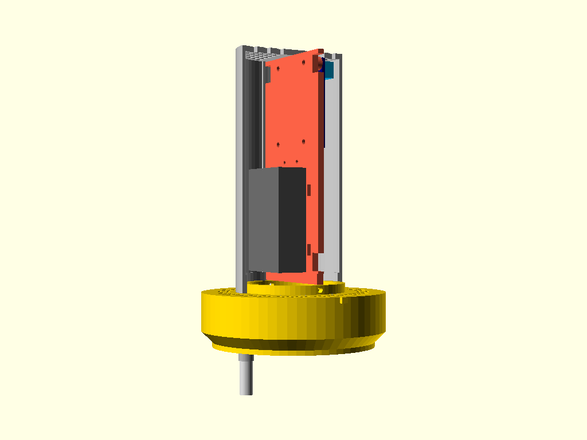

# Faceplate and tray

 

 

 

The assembly pictures show every module modeled in place (boards,
headers, pins and their Dupont plugs, the converter), from config.ts's
dimensions: look at them before printing. `mise run assembly` opens the
same assembly in OpenSCAD's window to turn it around in 3D (preview, F5,
keeps the colors); with Design > Automatic Reload and Preview on, it
follows each `mise run faceplate`.

Two printed parts (and a third way to mount it all, the vent pod, below):

- **The faceplate** holds the ST7789 2" display in portrait and the
  KY-040 encoder below it. The display shows through a beveled window the
  size of its lit area. From the back, the panel and its board drop into
  pockets and four M2 screws hold the board; the plate is relieved
  under the solder joints at both ends of the board. The encoder's shaft
  goes through the plate, its body in a recess, its board screwed onto
  standoffs, its header soldered on the back of the board (one on the
  knob side holds the board off the plate: desolder it, or set
  `encoder.pinsDepth` and the plate gets a channel for it); a threaded
  encoder can also take a nut from the front.
- **The tray** screws onto four posts at the faceplate's corners, 20 mm
  behind it. Its back carries the Pico W (across the top, components
  out) and the MCP2515 board on standoffs, and between them the potted
  12V-to-5V converter, its ears cut off (with them it's 74 mm long, the
  tray is 54): it lies between 2 low stops, a zip tie around it through
  2 holes in the tray, its micro-USB plug next to the Pico's socket.
  The Pico's 2 rows of pins go through 2 slots, so their Dupont plugs
  sit in the 20 mm gap with the display's and the encoder's instead of
  sticking out behind. The slots leave only a thin bridge at each end,
  where the tray snapped (off the bed, fitting the converter): a 6 mm
  rib on the back stiffens each one, clear of the Pico's micro-USB plug. The MCP2515's wires go around the tray's bottom
  edge.

So the whole thing is no bigger than the faceplate.

The wiring page's Dimensions tab (`bun run wiring`) draws every module
with the dimensions the parts are built for, marks which were measured,
and is where you enter them; hovering a row highlights what it measures.
Each value saves itself as you type it, to `data/measured.json` (it overrides
`config.ts`'s defaults), then the parts rebuild. A value the model
refuses stays saved: the page says which keys to look at.

## The vent pod

 

The whole dash in the driver's round air vent instead, where a 52 mm gauge
sat in a printed adapter (`resources/gauge_vent.stl`). Three parts, each
printed with no supports:

- **The face** (`pod-face`) takes the adapter's outside, so it sits in the
  vent the same way: its 73 mm lip on the driver's side, the 83 mm body
  into the vent's OEM ring, the 2 ears at the back. The step from the lip
  out to the body is a 45 degree bevel here, steeper on the adapter: the
  face prints front down. The lip carries the display in landscape behind
  its window, its board centered, and the encoder under it, held as on the
  faceplate. Behind them, a room for their wires narrows at 45 degrees to a
  spigot on the back. The ears are left and right of the display: if the
  vent wants them elsewhere, the face turns with them.
- **The can** (`pod-can`) goes into the vent's duct, about 11 cm behind
  the face (15 cm and more are free there). Its front band slides onto the
  spigot, 2 countersunk M3x6 screws through it into the spigot; the
  cable leaves through the hole in its back end. It prints on that end.
- **The sled** (`pod-sled`) slides into the can between 2 pairs of ribs
  and is held between the spigot and the can's back end, no screw. On top,
  the Pico (USB socket toward the front) then the MCP2515 (its terminal
  toward the back, by the cable's hole) on standoffs; under it, the
  converter, zip-tied through 4 slots. Notches in its edges let the wires
  go from one side to the other: the converter's USB plug up to the Pico at
  the front, the 12V down at the back. It prints flat.

The vent still blows, through a honeycomb like the adapter's grille: in
through the can's back end and, around the can, through the face's back;
along the boards and behind the display; out through the face around the
display and the encoder (about 380 mm² open there, against some
800 mm² guessed for the adapter's grille: the display and the encoder take
most of the 73 mm lip; the back lets in some 700). The electronics never sit in the
duct's still air.

The Dupont plugs don't fit in the can: solder the wires (or use
right-angle headers). The dimensions are in `config.ts`'s `pod` section;
the adapter's were read off its STL.

## Fit

The default dimensions come from sellers' listings, which disagree with
each other. Before printing, measure your modules with calipers and
enter them in the Dimensions tab (or `data/measured.json`; every key is
described in [`config.ts`](model/config.ts)). These matter most:

1. The display board's width and length, and its mounting holes' distance
   from the edges.
2. The panel (glass and backlight): its width, length and thickness, and
   where its top edge sits on the board.
3. The lit area's top edge, measured from the panel's top edge: it places
   the window.
4. If the encoder's collar is threaded: its length and the nut's
   thickness (none: leave the nut at 0).
5. The encoder's body height (board to face, where the bushing starts)
   and its board's holes: they set the standoffs it screws onto.
6. The encoder's board (length, width) and where its pin row sits from
   the shaft; `encoder.panelThickness`, the plate under its body, sets
   how far the collar and the shaft stick out.

A board's 4 holes sit on a rectangle centered on it: measure them center
to center, along its width and along its length.

Then `mise run faceplate` and look at the pictures. The build refuses a
layout that can't work and names the key to fix: a standoff off the tray,
on a tray screw, a plate too thick for the encoder's
nut or too thin for a channel under the encoder's pins, the Pico's pin
slots cutting into a screw hole or a rib into its micro-USB plug, the converter on a board or a tray
screw. The first print is a test fit: `clearance` sets the
play in every pocket and hole.

## Assembly

| Screws | For |
| --- | --- |
| 4 × M2x4 self-tapping | the display board, into the faceplate |
| 2 × M2x6 self-tapping | the encoder's board, into the faceplate |
| 4 × M2x5 self-tapping | the Pico, into the tray (an M2x6 would hit the bottom of its 4.7 mm hole) |
| 4 × M3x6 self-tapping | the MCP2515, into the tray |
| 4 × M3x10 self-tapping | the tray, onto the faceplate's posts |
| 1 zip tie, 4 mm wide at most | the converter, around it and through the tray |

1. Drop the display face down into its pocket, its header at the plate's
   outer edge, away from the encoder, and screw its board on.
2. Push the encoder through from the back, its header on the board's
   back, and screw its board onto the two
   standoffs under its holes (2 × M2x6); the two opposite only hold it
   level. A threaded encoder also takes its washer and nut from the
   front; without thread, the 2 screws hold it alone. If the encoder has an anti-rotation
   tab sticking out of its face, break it off: there's no slot for it.
3. Screw the boards onto the tray's back: the Pico components out, its
   pins through the 2 slots; the MCP2515 components out. Cut the
   converter's ears off flush with its box, lay it between the stops,
   zip-tie it through the 2 holes, and plug its micro-USB into the Pico.
4. Push the Dupont plugs onto the Pico's pins from the tray's front:
   the display's and the encoder's, and the MCP2515's around the tray's
   bottom edge.
5. Screw the tray onto the posts.

Neither part has a way to fix the whole thing in the car for good yet: that
depends on where it goes.

### On an air vent, for testing

A clamp hangs the dash on one horizontal slat of the central vent (either
half), for a test drive, with no change to the faceplate or the tray:

- `stl/vent-bar.stl`: a bar across the tray's back under its 2 top screws,
  and the upper leg, going into the vent above the slat.
- `stl/vent-jaw.stl`: the lower leg, under the slat. Its heel bears on the
  upper leg, so the screw closes the two like pliers.
- `stl/vent-wheel.stl`: the thumbwheel. Press an M3x12 socket head screw's
  head into it from below (warm it with a soldering iron, or a drop of
  glue); the hole on top takes the hex key.
- `stl/vent-feet.stl`: 2 tubes on the bottom posts, resting on what's
  under the vent (the vent is shorter than the dash), so the dash stands
  square and doesn't turn with the slat.

| Screws | For |
| --- | --- |
| 2 × M3x14 self-tapping | the top of the tray, through the bar (instead of 2 M3x10) |
| 2 × M3x30 self-tapping | the bottom of the tray, through the feet (instead of 2 M3x10) |
| 1 × M3x12 socket head | the clamp: through the wheel and the upper leg, biting into the jaw |

Slide the upper leg over the slat and the jaw under it, push the screw
through the upper leg into the jaw, and turn the wheel until it holds.

The `vent` dimensions in `model/config.ts` are guesses: measure the slat
(thickness, and depth up to the vertical vanes behind it: the legs stop
1 mm short), the gap between two slats, how far the vent's face will sit
from the tray's back, and how far what's under the vent will; then rerun
`mise run faceplate`. The model refuses a leg too thick for the gap, a
wheel with no room between the tray and the vent, a jaw on the Pico.
`renders/vent-mount.png` shows it in place from the side,
`renders/vent-clamp.png` the clamp alone.

## Printing

Print `stl/faceplate.stl` and `stl/tray.stl`, each front face down on the bed (the vent mount's parts lie as they print: the bar on its top face, the jaw on its side, the wheel and the feet standing): the pockets open upward, the posts
and standoffs stand up, the window bevel is a 45 degree overhang, so the
faceplate needs no supports, nor does the tray: their 2 mm rims are on
their backs only. PETG or ASA rather than PLA, which softens in a car parked in
the sun.
