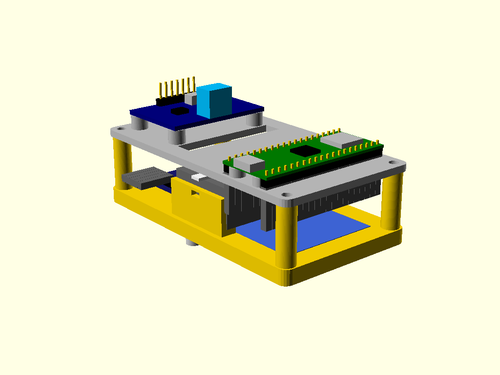
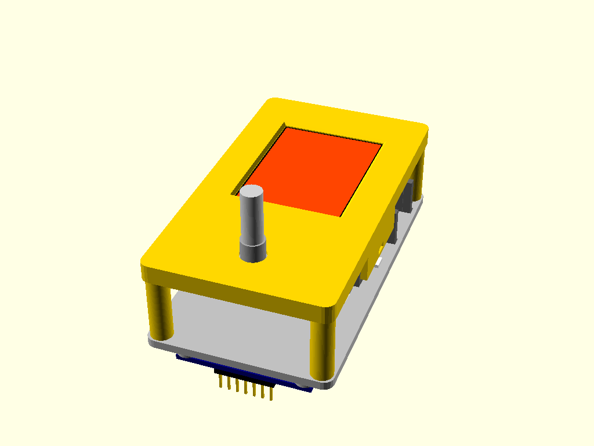
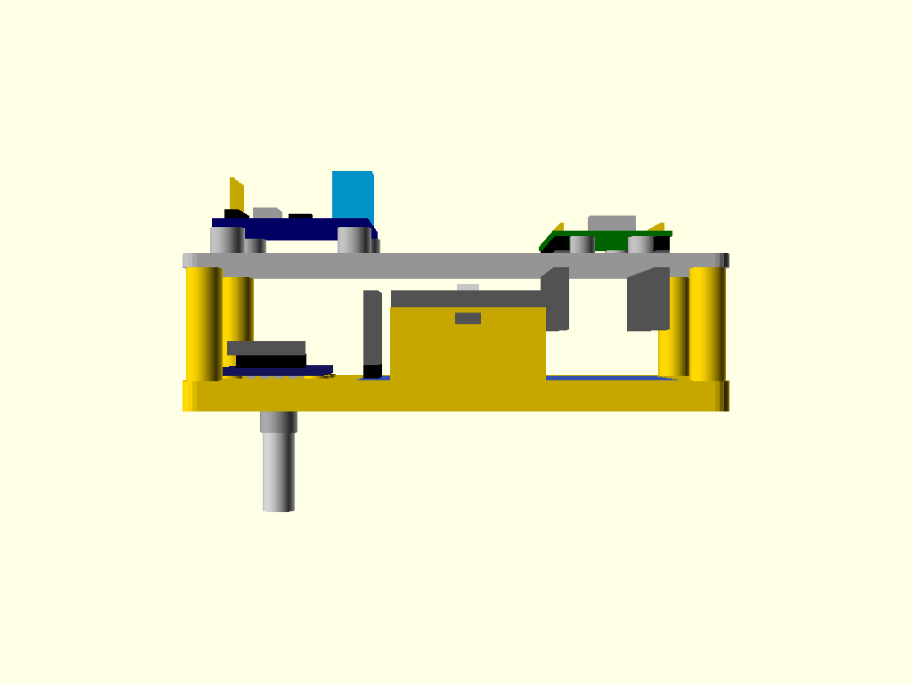

# Faceplate and tray

 

 

 

The assembly pictures show every module modeled in place (boards,
headers, pins and their Dupont plugs, the converter), from config.ts's
dimensions: look at them before printing. `mise run assembly` opens the
same assembly in OpenSCAD's window to turn it around in 3D (preview, F5,
keeps the colors); with Design > Automatic Reload and Preview on, it
follows each `mise run faceplate`.

Two printed parts:

- **The faceplate** holds the ST7789 2" display in portrait and the
  KY-040 encoder below it. The display shows through a beveled window the
  size of its lit area. From the back, the panel and its board drop into
  pockets and four M2 screws hold the board; the plate is relieved
  under the solder joints at both ends of the board. The encoder's shaft
  goes through the plate, its body in a recess, its board screwed onto
  standoffs, its header soldered on the back of the board (one on the
  knob side holds the board off the plate: desolder it, or set
  `encoder.pinsDepth` and the plate gets a channel for it); a threaded
  encoder can also take a nut from the front.
- **The tray** screws onto four posts at the faceplate's corners, 20 mm
  behind it. Its back carries the Pico W (across the top, components
  out) and the MCP2515 board, on standoffs. The Pico's 2 rows of pins go
  through 2 slots, so their Dupont plugs sit in the gap instead of
  sticking out behind. Other wires go through a slot.

Everything else fits in that 20 mm gap, which is why the whole thing is
no bigger than the faceplate: the Pico's plugs at the top, the potted
12V-to-5V converter across the display's back in the middle (its ears
cut off: with them it's 74 mm long, the plate is 54), the display's
plugs at the bottom. The converter rests its ends on 2 ledges between 2
stops, a zip tie through the stops over it; its micro-USB plug goes
through the wire slot into the Pico.

The wiring page's Dimensions tab (`bun run wiring`) draws every module
with the dimensions the parts are built for, marks which were measured,
and is where you enter them; hovering a row highlights what it measures.
Each value saves itself as you type it, to `data/measured.json` (it overrides
`config.ts`'s defaults), then the parts rebuild. A value the model
refuses stays saved: the page says which keys to look at.

## Fit

The default dimensions come from sellers' listings, which disagree with
each other. Before printing, measure your modules with calipers and
enter them in the Dimensions tab (or `data/measured.json`; every key is
described in [`config.ts`](model/config.ts)). These matter most:

1. The display board's width and length, and its mounting holes' distance
   from the edges.
2. The panel (glass and backlight): its width, length and thickness, and
   where its top edge sits on the board.
3. The lit area's top edge, measured from the panel's top edge: it places
   the window.
4. If the encoder's collar is threaded: its length and the nut's
   thickness (none: leave the nut at 0).
5. The encoder's body height (board to face, where the bushing starts)
   and its board's holes: they set the standoffs it screws onto.
6. The encoder's board (length, width) and where its pin row sits from
   the shaft; `encoder.panelThickness`, the plate under its body, sets
   how far the collar and the shaft stick out.

A board's 4 holes sit on a rectangle centered on it: measure them center
to center, along its width and along its length.

Then `mise run faceplate` and look at the pictures. The build refuses a
layout that can't work and names the key to fix: a standoff off the tray,
on a tray screw or in the wire slot, a plate too thick for the encoder's
nut or too thin for a channel under the encoder's pins, the Pico's pin
slots cutting into a screw hole, the converter on the Pico's or the
display's plugs. The first print is a test fit: `clearance` sets the
play in every pocket and hole.

## Assembly

| Screws | For |
| --- | --- |
| 4 × M2x4 self-tapping | the display board, into the faceplate |
| 2 × M2x6 self-tapping | the encoder's board, into the faceplate |
| 4 × M2x6 self-tapping | the Pico, into the tray |
| 4 × M3x6 self-tapping | the MCP2515, into the tray |
| 4 × M3x10 self-tapping | the tray, onto the faceplate's posts |
| 1 zip tie, 4 mm wide at most | the converter, through its 2 stops |

1. Drop the display face down into its pocket, ribbon end toward the
   encoder, and screw its board on.
2. Push the encoder through from the back, its header on the board's
   back, and screw its board onto the two
   standoffs under its holes (2 × M2x6); the two opposite only hold it
   level. A threaded encoder also takes its washer and nut from the
   front; without thread, the 2 screws hold it alone. If the encoder has an anti-rotation
   tab sticking out of its face, break it off: there's no slot for it.
3. Cut the converter's ears off flush with its box, lay it across the
   display's back, its ends on the ledges between the stops, and pull a
   zip tie through the stops over it. Plug the display's and the
   encoder's wires.
4. Screw the boards onto the tray: the Pico components out, its pins
   through the 2 slots; the MCP2515 components out. Push the Pico's
   Dupont plugs onto its pins from the tray's front, and the converter's
   micro-USB through the wire slot into the Pico.
5. Screw the tray onto the posts.

Neither part has a way to fix the whole thing in the car yet: that depends
on where it goes.

## Printing

Print `stl/faceplate.stl` and `stl/tray.stl`, each front face down on the bed: the pockets open upward, the posts
and standoffs stand up, the window bevel is a 45 degree overhang, so no
supports. PETG or ASA rather than PLA, which softens in a car parked in
the sun.
