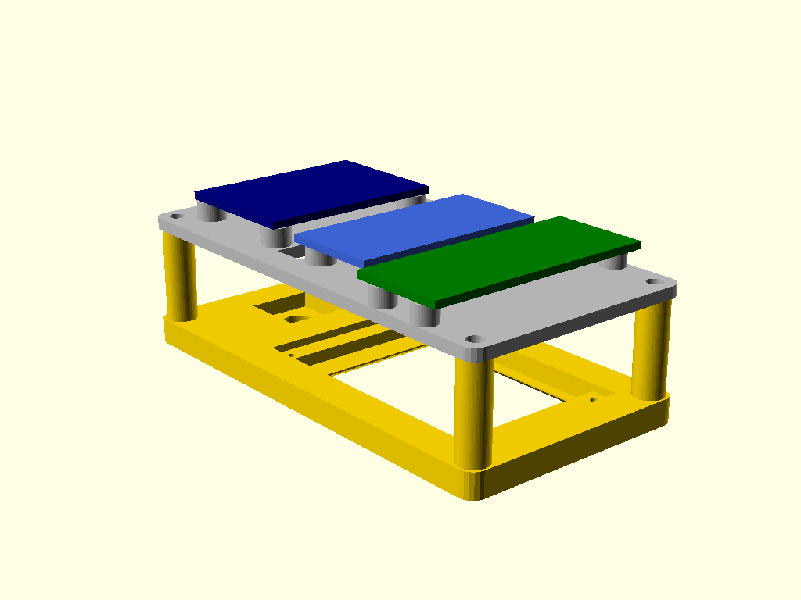
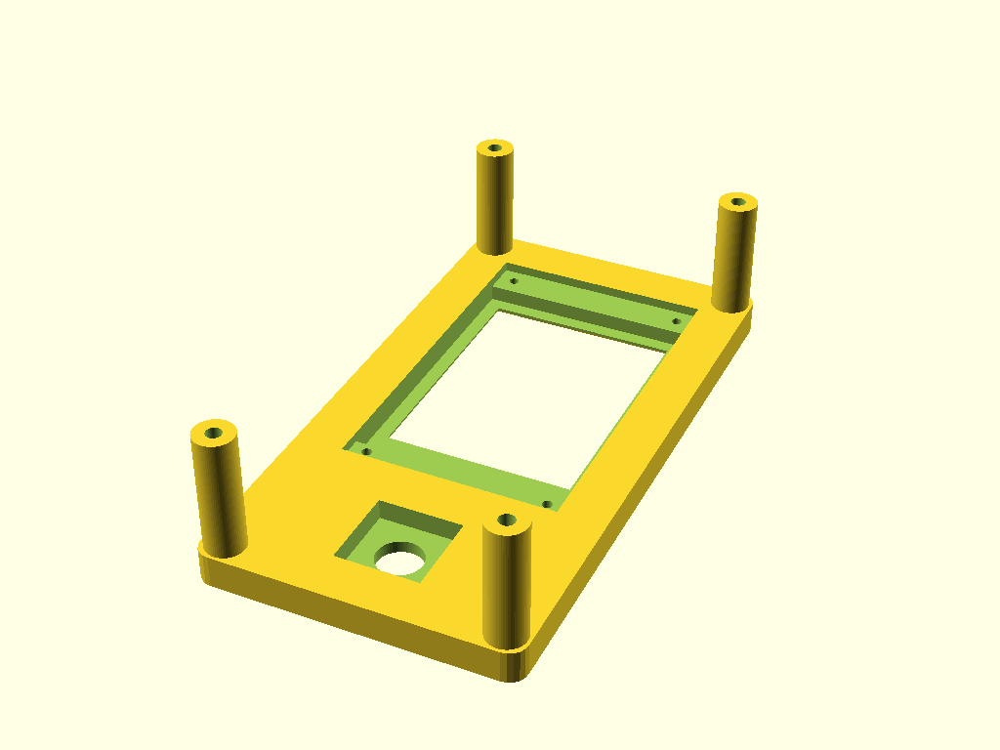
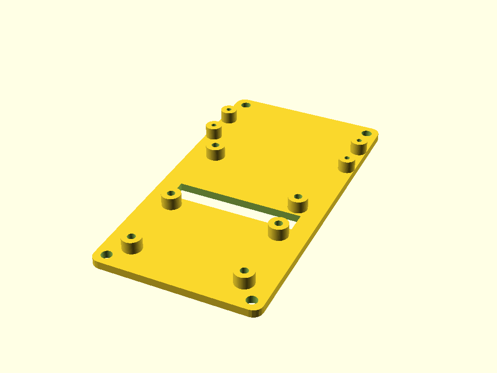

# Faceplate and tray

 

 

Two printed parts:

- **The faceplate** holds the ST7789 2" display in portrait and the
  KY-040 encoder below it. The display shows through a beveled window the
  size of its lit area. From the back, the panel and its board drop into
  pockets and four M2 screws hold the board. The encoder's bushing goes
  through the plate, which is thin around it so the nut clamps it from the
  front.
- **The tray** screws onto four posts at the faceplate's corners, 20 mm
  behind it: room for the display's and the encoder's connectors. Its back
  carries the Pico W (across the top, its USB socket out over the side),
  the 12V-to-5V buck converter and the MCP2515 board, on standoffs. The
  wires go through a slot.

## Fit

The default dimensions come from sellers' listings, which disagree with
each other. Before printing, measure your modules with calipers and set
them in [`config.ts`](config.ts), where every key says what it is. These
matter most:

1. The display board's width and length, and its mounting holes' distance
   from the edges.
2. The panel (glass and backlight): its width, length and thickness, and
   where its top edge sits on the board.
3. The lit area's top edge, measured from the panel's top edge: it places
   the window.
4. The encoder's threaded length: the plate around it must leave room for
   the nut.
5. The buck converter's holes: the defaults are a guess at an LM2596
   module. Holes are measured from the board's bottom-left corner, looking
   at it from the back of the dash.

Then `mise run faceplate` and look at the pictures. The build refuses a
layout that can't work and names the key to fix: a standoff off the tray,
on a tray screw or in the wire slot, a plate too thick for the encoder's
nut. The first print is a test fit: `clearance` sets the play in every
pocket and hole.

## Assembly

| Screws | For |
| --- | --- |
| 4 × M2x4 self-tapping | the display board, into the faceplate |
| 4 × M2x6 self-tapping | the Pico, into the tray |
| 6 × M3x6 self-tapping | the buck converter and the MCP2515, into the tray |
| 4 × M3x10 self-tapping | the tray, onto the faceplate's posts |

1. Drop the display face down into its pocket, ribbon end toward the
   encoder, and screw its board on.
2. Push the encoder through from the back, with its pin header pointing
   down, out past the plate's bottom edge (sideways, it hits a post). Put
   the washer and nut on from the front. If the encoder has an
   anti-rotation tab sticking out of its face, break it off: there's no
   slot for it.
3. Wire the display and the encoder, pass the wires through the tray's
   slot, and screw the tray onto the posts.
4. Screw the boards onto the tray: the Pico with its components facing
   the tray and its pins pointing out, the other two components out.

Neither part has a way to fix the whole thing in the car yet: that depends
on where it goes.

## Printing

Each part front face down on the bed: the pockets open upward, the posts
and standoffs stand up, the window bevel is a 45 degree overhang, so no
supports. PETG or ASA rather than PLA, which softens in a car parked in
the sun.
