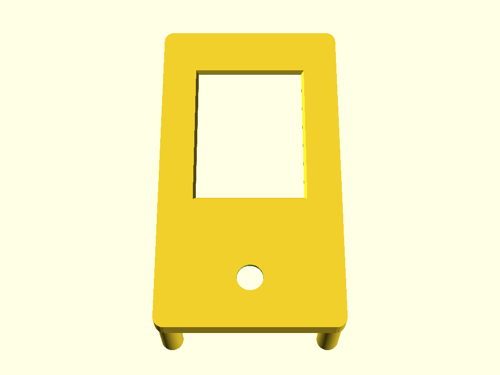

# Faceplate and tray

 

 

Two printed parts:

- **The faceplate** holds the ST7789 2" display in portrait and the
  KY-040 encoder below it. The display shows through a beveled window the
  size of its lit area. From the back, the panel and its board drop into
  pockets and four M2 screws hold the board. The encoder's shaft goes
  through the plate, its body in a recess, its board screwed onto
  standoffs; a threaded one can also take a nut from the front.
- **The tray** screws onto four posts at the faceplate's corners, 20 mm
  behind it: room for the display's and the encoder's connectors. Its back
  carries the Pico W (across the top, its USB socket out over the side)
  and the MCP2515 board, on standoffs. The wires go through a slot.

The potted 12V-to-5V converter isn't on the tray: with its mounting ears
it's 74 mm long, the tray is narrower. Zip-tie it on the harness behind
the dash; its micro-USB plug goes into the Pico.

The wiring page's Dimensions tab (`bun run wiring`) draws every module
with the dimensions the parts are built for, marks which were measured,
and is where you enter them; hovering a row highlights what it measures.
Each value saves itself as you type it, to `measured.json` (it overrides
`config.ts`'s defaults), then the parts rebuild. A value the model
refuses stays saved: the page says which keys to look at.

## Fit

The default dimensions come from sellers' listings, which disagree with
each other. Before printing, measure your modules with calipers and
enter them in the Dimensions tab (or `measured.json`; every key is
described in [`config.ts`](config.ts)). These matter most:

1. The display board's width and length, and its mounting holes' distance
   from the edges.
2. The panel (glass and backlight): its width, length and thickness, and
   where its top edge sits on the board.
3. The lit area's top edge, measured from the panel's top edge: it places
   the window.
4. If the encoder's collar is threaded: its length and the nut's
   thickness (none: leave the nut at 0).
5. The encoder's body height (board to face, where the bushing starts)
   and its board's holes: they set the standoffs it screws onto.

A board's 4 holes sit on a rectangle centered on it: measure them center
to center, along its width and along its length.

Then `mise run faceplate` and look at the pictures. The build refuses a
layout that can't work and names the key to fix: a standoff off the tray,
on a tray screw or in the wire slot, a plate too thick for the encoder's
nut, a keepout (the Pico's USB socket) cutting into a screw hole. The first print is a test fit: `clearance` sets the play in every
pocket and hole.

## Assembly

| Screws | For |
| --- | --- |
| 4 × M2x4 self-tapping | the display board, into the faceplate |
| 2 × M2x6 self-tapping | the encoder's board, into the faceplate |
| 4 × M2x6 self-tapping | the Pico, into the tray |
| 4 × M3x6 self-tapping | the MCP2515, into the tray |
| 4 × M3x10 self-tapping | the tray, onto the faceplate's posts |

1. Drop the display face down into its pocket, ribbon end toward the
   encoder, and screw its board on.
2. Push the encoder through from the back, with its pin header pointing
   to one side, inside the dash, and screw its board onto the two
   standoffs under its holes (2 × M2x6); the two opposite only hold it
   level. A threaded encoder also takes its washer and nut from the
   front; without thread, the 2 screws hold it alone. If the encoder has an anti-rotation
   tab sticking out of its face, break it off: there's no slot for it.
3. Wire the display and the encoder, pass the wires through the tray's
   slot, and screw the tray onto the posts.
4. Screw the boards onto the tray: the Pico with its components facing
   the tray, its pins pointing out and its USB socket between the two
   standoffs cut flat for it; the MCP2515 components out.

Neither part has a way to fix the whole thing in the car yet: that depends
on where it goes.

## Printing

Each part front face down on the bed: the pockets open upward, the posts
and standoffs stand up, the window bevel is a 45 degree overhang, so no
supports. PETG or ASA rather than PLA, which softens in a car parked in
the sun.
