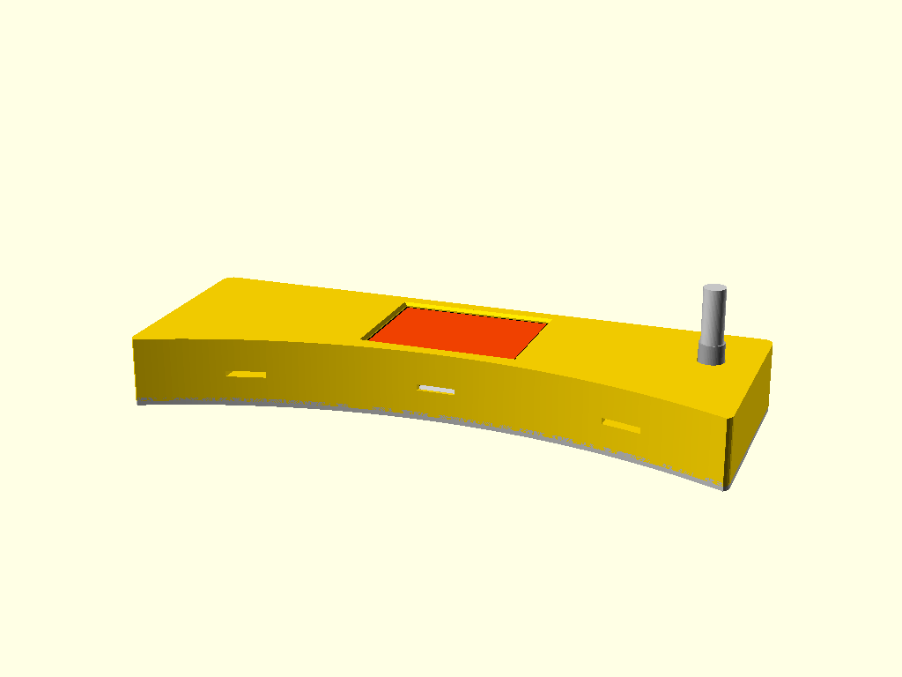

# The bar

 

The modules in one long, thin box laid on the steering column's shroud,
along its length instead of stacked: 164 x 41 x 34 mm (46 at the ends,
over the arc), the display in the middle. On one side the encoder, its knob out the front, then the
converter's micro-USB plug in the Pico's socket; on the other the MCP2515.
The display is in landscape with the Pico right behind it (below). The
converter stays out, on the cable by the fuse box. Three parts, printed with no supports:

- **The shell** (`bar-shell`) holds the display and the encoder
  (`shared/front.ts`: the window, the pockets, the encoder's recess and its
  board's standoffs), its front as thick as they need there and thin under
  the MCP2515. No screw: the display's board goes onto 4 pins through its
  corner holes, the encoder's onto 2 through its 2 holes (on the standoffs
  on one side of its shaft, the other 2 hold it level: turn the board so
  its holes land on the pins), the MCP2515 onto 4 standoffs whose pins go
  through its holes: flatten each pin's tip into a head with the soldering
  iron. `encoder.holeDiameter` (3 mm) is a guess: measure it. Its bottom is hollowed into an arc, its axis front to back like the
  column's, to sit on the shroud: `bar.shroudSag` deeper at the ends than
  in the middle, on the base. It prints front down.
- **The lid** (`bar-lid`) is a tray 15 mm deep (`bar.lidExtra`: the
  wires' room) sitting on the shell's walls, a skirt down inside its top
  and bottom walls, a bump on it clicking into each of the shell's 6 slots
  (0.6 mm, `bar.bumpDepth`). No tab: snap tabs, printed standing, bend
  across their layers and broke; a skirt that long bends along its
  length. To take it off, push the 3 bumps of one side back in through
  their slots (the bottom ones through the arc) with a small screwdriver
  and lift that side. The Pico stands on its back (below), either
  way up. Over the plug, an opening the
  converter's cable goes out through: pull the plug out through it to plug
  the computer in and flash, the lid on. CAN-H and CAN-L leave through the
  slot over the MCP2515's terminal. Slots across its back let the heat out. Its walls are enclosure.wall thick along the arc too, widening in 45 degree steps to the skirt: no support. It prints
  back down.

- **The base** (`bar-base`) is the only part stuck in the car: VHB tape
  under it, on the shroud. The bar clips into it as printed, with nothing
  added to the bar. It's a floor 2 mm thick (`bar.baseThickness`) under
  the bar's arc, the whole depth, with a hook up each end wall. Each
  hook's lip reaches 3 mm over the bar's top (`bar.baseLip`), past its
  rounded corner. The lip is flat underneath, so it holds the bar down,
  and 45 degrees on top, so the bar spreads the hooks going in. A lip
  rises across the front (3 mm, `bar.baseLipFront`, under the display's
  window) and the back (4 mm, `bar.baseLipBack`, under the lid's vents),
  so the bar can't slide out either way.
  - To put the bar in, press it straight down until both ends click.
  - To take it out, pull one hook outward with a thumb, lift that end,
    then do the other.
  - The hooks bend about 0.5% at their root, fine in any plastic.
  - Clip the bar in first, then stick the base on the shroud with the bar
    in it: the bar lines it up.
  - It prints standing on its front edge, so the hooks bend within their
    layers, never across them (the tabs that broke did). The back lip
    prints last: 1.5 mm straight up, printed in the air, then its inside
    slopes back at 45 degrees.

The plug gets what's left between the encoder and the display once the
display sits in the middle (29 mm, `bar.plugRoomMin` at least). The
MCP2515 lies with its header toward the display and its terminal toward
the end. Its terminal block is taken as 10 mm tall (`bar.mcpTallest`) over
standoffs 3 mm tall: measure yours, the build refuses one that hits the
lid.

## The display and the Pico

The Pico sits behind the display, not beside it: the box is as thick
either way, and beside it would add 55 mm of length. It has to stay by
the display anyway: its SPI runs at 62.5 MHz, which a long cable won't
carry; the MCP2515's (1 MHz) and the encoder's wires will.

- The display's board goes onto 4 pins through its corner holes (30.5 x
  53 mm apart, 3 mm across: the pins are made 0.6 mm thinner), melted
  into heads with the soldering iron (a flat tip, low heat, a second or
  two).
- The Pico stands on the lid, either way up, on 4 standoffs 6 mm tall
  whose pins go through its holes, melted the same way: under it, room
  for its debug connector (about 5 mm), its USB plug and the wires. The
  standoffs (3.4 mm) fit between the header's 2 rows of plastic, each cut
  flat inside, 8.6 mm between them, so the USB socket passes whichever way
  up the Pico goes. The pins by the socket stand only 0.6 mm past the
  board, for a smaller head: a full one would touch the socket.
- Cut the Pico's long pins flush with the plastic and solder the wires on
  their short tips before melting the pins: no Dupont plug fits. The
  display's header gets the same.
- Between the Pico and the display, 5.5 mm: room for the wires soldered on
  the Pico's pin tips and bent over, in 26 AWG silicone wire at most (30
  AWG wire-wrap wire leaves plenty).

PLA is for the test print; the one for the car in PETG, or better ASA.
`mise run bar` opens it in OpenSCAD. The dimensions are in
[`config.ts`](config.ts) (the box's in `enclosure`), the modules' in
[`shared/config.ts`](../shared/config.ts).
