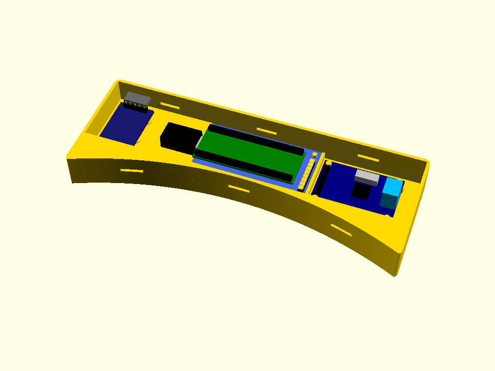

# The bar

 

The modules in one long, thin box laid on the steering column's shroud,
along its length instead of stacked: 164 x 41 x 19 mm, the display in the
middle. On one side the encoder, its knob out the front, then the
converter's micro-USB plug in the Pico's socket; on the other the MCP2515.
The display is in landscape with the Pico right behind it, built as
[the head's](../head/README.md). The converter stays out, on the cable by
the fuse box. Two parts, printed with no supports:

- **The shell** (`bar-shell`) holds the display and the encoder as the
  faceplate does (the window, the pockets, the encoder's recess and its
  board's standoffs, M2 self-tapping screws), its front as thick as they
  need there and thin under the MCP2515. The display's board goes onto 4
  pins through its corner holes, the MCP2515 onto 4 standoffs whose pins go
  through its holes: flatten each pin's tip into a head with the soldering
  iron. Its bottom is hollowed into an arc, its axis front to back like the
  column's, to sit on the shroud: 17 mm deeper at the ends than in the
  middle, VHB tape on it (not over a hook's slot). It prints front down.
- **The lid** (`bar-lid`) clips on with 3 pairs of tabs: to take it off,
  push the hooks of one side back in through their slots (the bottom ones
  through the arc) with a small screwdriver and lift that side. The Pico
  stands on it as in the head, either way up. Over the plug, an opening the
  converter's cable goes out through: pull the plug out through it to plug
  the computer in and flash, the lid on. CAN-H and CAN-L leave through the
  slot over the MCP2515's terminal. A honeycomb lets the heat out. It prints
  outside down.

The plug gets what's left between the encoder and the display once the
display sits in the middle (29 mm, `bar.plugRoomMin` at least). The
MCP2515 lies with its header toward the display and its terminal toward
the end. Its terminal block is taken as 10 mm tall (`bar.mcpTallest`) over
standoffs 3 mm tall: measure yours, the build refuses one that hits the
lid.

**Print `bar-wireframe` first**: the bar's outline as a flat frame, 3 mm
wide, 2 mm thick, in a few minutes, to check its length and its bottom's
arc on the shroud before the real parts.

`bar.shroudRadius` (200 mm) is a guess: lay a ruler `w` long across the
shroud, measure the gap `h` under its middle, the radius is
`(w * w / 4 + h * h) / (2 * h)`.

The Pico sits behind the display, not beside it: the box is as thick
either way, and beside it would add 55 mm of length.

PLA is for the test print; the one for the car in PETG, or better ASA.
`mise run bar` opens it in OpenSCAD. The dimensions are in
[`config.ts`](config.ts), the display's, the Pico's and the lid's in the
head's.
