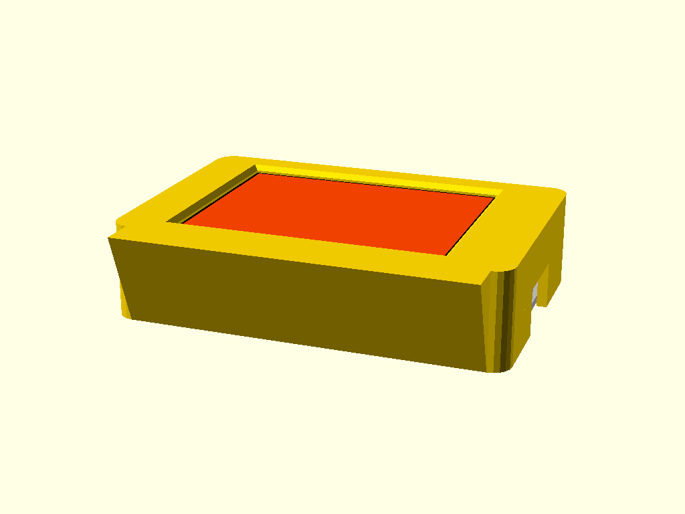
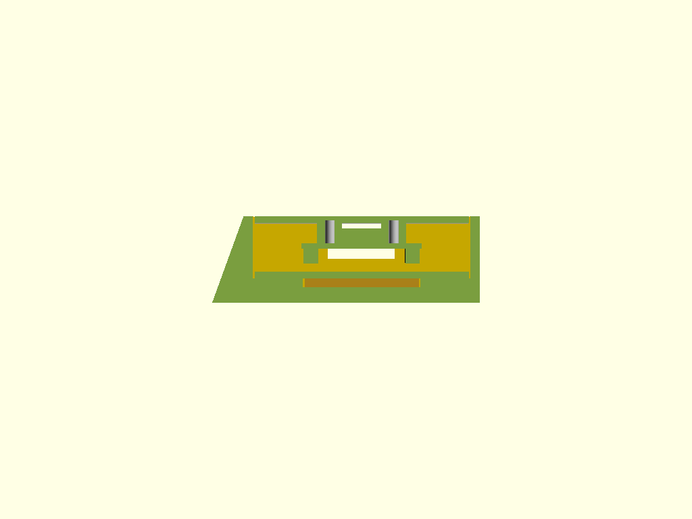

# The head

 

The smallest box, for up high (the meter hood's top, in the driver's line
of sight): the display in landscape and the Pico W right behind it, about
62 x 41 x 15 mm, a 20 degree wedge under it. Everything else goes on a
cable, out of sight: the MCP2515 and the converter at the OBD port (both
heat-shrunk, no box), the encoder wherever the hand falls. The Pico has
to stay by the display: its SPI runs at 62.5 MHz, which a long cable
won't carry; the MCP2515's (1 MHz) and the encoder's wires will. Two
parts, printed with no supports:

- **The shell** (`head-shell`) holds the display as the faceplate does
  (the window, the pockets, its 4 M2 screws), its walls just around the
  board. Behind it, a room for the Pico, a notch in the end by the Pico's
  USB socket for the plug (flashing), and 2 bosses for the lid's screws.
  The wedge under it leans the screen back toward the eyes; its face takes
  3M VHB tape. It prints front down.
- **The lid** (`head-lid`) closes the back with 2 M2x5 screws. The Pico
  hangs under it on 4 standoffs (M2x5), components toward the lid, its
  header's plastic toward the display: cut the long pins flush with the
  plastic and solder the wires on their short tips, no Dupont plug fits.
  The display's header gets the same: pins cut past the plastic, wires
  soldered. A honeycomb in the lid lets the heat out; the cable (6 wires
  to the OBD end, 4 to the encoder) leaves through the hole under the
  Pico. It prints outside down.

PLA is for the test print: the top of the dash in the sun gets past 60°C,
where PLA sags. The one for the car in PETG, or better ASA. `head.tilt`
is a guess: set it from the hood's slope. `mise run head` opens it in
OpenSCAD. The dimensions are in [`config.ts`](config.ts).
