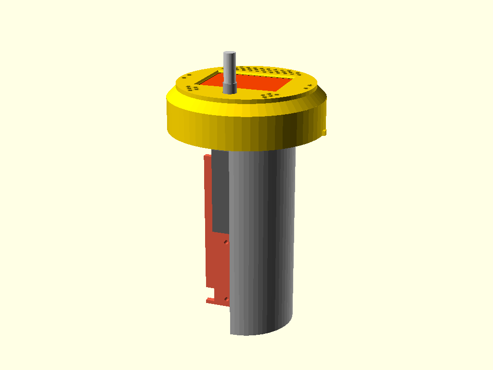
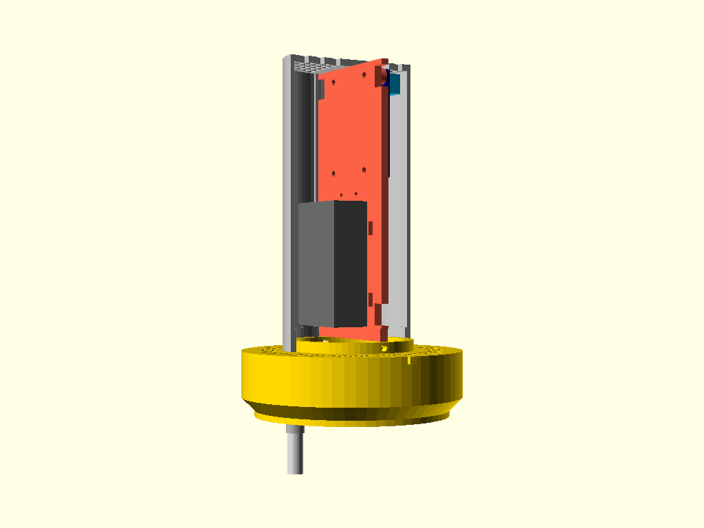

# The vent pod

 

The whole dash in the driver's round air vent instead, where a 52 mm gauge
sat in a printed adapter ([`resources/gauge_vent.stl`](resources/gauge_vent.stl)). Three parts, each
printed with no supports:

- **The face** (`pod-face`) takes the adapter's outside, so it sits in the
  vent the same way: its 73 mm lip on the driver's side, the 83 mm body
  into the vent's OEM ring, the 2 ears at the back. The step from the lip
  out to the body is a 45 degree bevel here, steeper on the adapter: the
  face prints front down. The lip carries the display in landscape behind
  its window, its board centered, and the encoder under it, held as on the
  faceplate. Behind them, a room for their wires narrows at 45 degrees to a
  spigot on the back. The ears are left and right of the display: if the
  vent wants them elsewhere, the face turns with them.
- **The can** (`pod-can`) goes into the vent's duct, about 11 cm behind
  the face (15 cm and more are free there). Its front band slides onto the
  spigot, 2 countersunk M3x6 screws through it into the spigot; the
  cable leaves through the hole in its back end. It prints on that end.
- **The sled** (`pod-sled`) slides into the can between 2 pairs of ribs
  and is held between the spigot and the can's back end, no screw. On top,
  the Pico (USB socket toward the front) then the MCP2515 (its terminal
  toward the back, by the cable's hole) on standoffs; under it, the
  converter, zip-tied through 4 slots. Notches in its edges let the wires
  go from one side to the other: the converter's USB plug up to the Pico at
  the front, the 12V down at the back. It prints flat.

The vent still blows, through a honeycomb like the adapter's grille: in
through the can's back end and, around the can, through the face's back;
along the boards and behind the display; out through the face around the
display and the encoder (about 380 mm² open there, against some
800 mm² guessed for the adapter's grille: the display and the encoder take
most of the 73 mm lip; the back lets in some 700). The electronics never sit in the
duct's still air.

The Dupont plugs don't fit in the can: solder the wires (or use
right-angle headers). The dimensions are in [`config.ts`](config.ts);
the adapter's were read off its STL.
